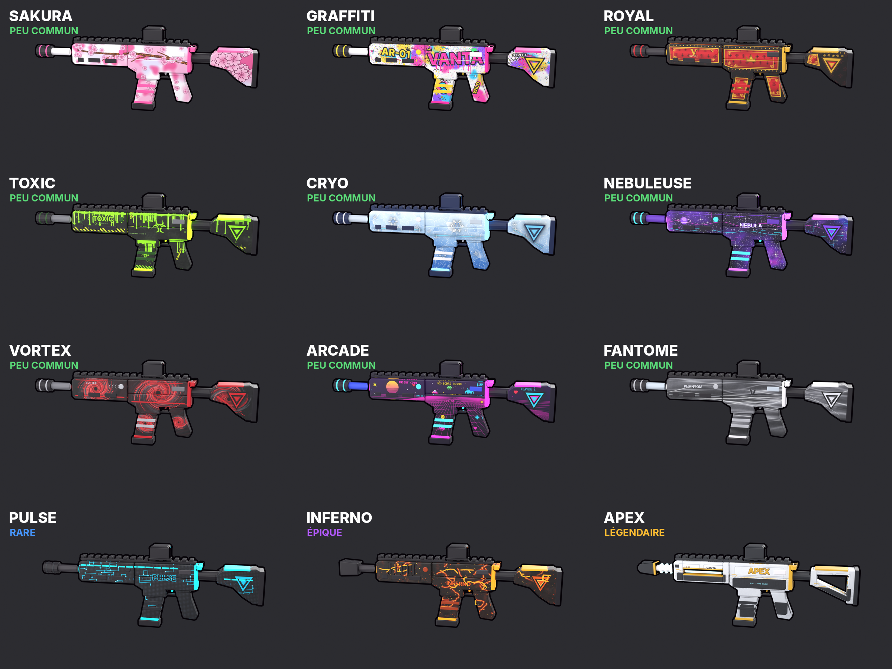

# MODEL-ROBLOX

Modèles 3D (Blender) pour le jeu Roblox, générés par script.

## Convention des armes

- Canon vers **+X**, haut vers **+Z**, origine sur la **poignée**
- Même structure que `Phantom P` dans Roblox :

```
Phantom <Skin> (Model)  -> renommé « Phantom S N » par le script
├── Corps     Body_<Skin>, Body_<Couleurs>..., Body_Verre<Teinte>, Body_Contour
├── Chargeur  Magazine_<Skin>, Magazine_<Couleurs>..., Magazine_Contour
├── Gachette  Trigger, Trigger_Contour
├── Levier    ChargingHandle_<Couleurs>..., ChargingHandle_Contour
└── Root      repère sur la poignée
```

- Une pièce = une couleur (`Body_<Skin>` / `Magazine_<Skin>` = texture du skin). `*_Contour` = contour noir
  cartoon (coque inversée, visible uniquement de l'extérieur).

| Arme | Studs (L × H × É) | Blender (m) |
|---|---|---|
| VANTA AR-01 | 3,616 × 1,343 × 0,369 | 1,096 × 0,407 × 0,112 |
| VANTA SR-7 (sniper) | 4,862 × 1,329 × 0,760 | 1,473 × 0,403 × 0,230 |
| VANTA DE-50 (deagle) | 1,250 × 0,856 × 0,660 | 0,379 × 0,259 × 0,200 |
| Couteau | 1,625 × 0,426 × 0,200 | 0,387 × 0,101 × 0,048 |

**Échelle :** les `.blend` sont en mètres (tableau ci-dessus). Les `.fbx` sont exportés
avec **1 unité = 1 stud**, à importer avec *Scale Unit = Stud*. (Un FBX Blender par
défaut est lu par Roblox comme 1 m = 100 studs : c'est ce qui donnait une arme géante.)

## Skins de la VANTA AR-01



| # | Skin | Style | Couleurs (pièces) |
|---|---|---|---|
| 1 | Sakura | fleurs de cerisier, nuages roses | Rose, Noir, Blanc |
| 2 | Graffiti | street art, tags, aérosol, coulures | RoseVif, Jaune, Noir, Blanc |
| 3 | Royal | laque rouge, filigranes dorés, couronnes | Or, Rouge, Noir |
| 4 | Toxic | slime fluo, biohazard, bandes de danger | VertAcide (néon), VertSombre, Noir |
| 5 | Cryo | glace à facettes, givre, flocons | BleuGlace (néon), BleuNuit, Argent |
| 6 | Nebuleuse | galaxie, étoiles, lignes lumineuses | VioletNeon, CyanNeon, NoirViolet |
| 7 | Vortex | tourbillons rouges sur noir fumé | Rouge, GrisClair, Noir |
| 8 | Arcade | grille synthwave, pixel art, néons | MagentaNeon, CyanNeon, Bleu |
| 9 | Fantome | fumée blanche sur noir, minimaliste | Blanc, GrisClair, Argent |

Chaque skin : `weapons/VANTA_AR-01/<Skin>/Phantom_<Skin>.fbx` (+ `.blend`, textures, aperçu).
Les 8 nouveaux FBX d'un coup : `weapons/VANTA_AR-01/Skins_AR-01_FBX.zip` (Sakura, déjà installé en
`Phantom S 1`, n'y est pas ; son FBX reste dans `Sakura/`).

## Skins Rare / Épique / Légendaire (test sur la VANTA AR-01)

| Skin | Rareté | Modèle | Effets (module `roblox/EffetsSkins.lua`) |
|---|---|---|---|
| Pulse | Rare | Phantom + 16 segments néon | onde de lumière, éclat au tir, rallumage au rechargement |
| Inferno | Épique | Phantom + fissures de lave, ailettes, cache-flamme | lave qui pulse, braises, étincelles au tir, fumée |
| Apex | Légendaire | modèle exclusif (crosse squelette, noyau, anneaux) | noyau, anneaux qui tournent, inspection F, effet d'élimination |

- FBX : `weapons/VANTA_AR-01/Skins_AR-01_RareEpiqueLegendaire_FBX.zip`
- Intégration dans les scripts du jeu : `roblox/INTEGRATION_EFFETS.md` (réponse à `roblox/BRIEFING_SKINS_RARES.md`)
- Variantes de modèle : `scripts/phantom_variants.py` ; skins : `scripts/skins/pulse.py`, `inferno.py`, `apex.py`

## Autres armes (skin Sakura)

| Arme | Dossier Roblox | Structure | FBX |
|---|---|---|---|
| VANTA DE-50 (deagle) | `Armes.Deagle` | Corps, Chargeur, Gachette, **Levier = culasse** (+ organes de visée) | `weapons/VANTA_DE-50/Sakura/Deagle_Sakura.fbx` |
| VANTA SR-7 (sniper) | `Armes.Sniper` | Corps (lunette : `Body_Lentille*`), Chargeur, Gachette, **Levier = poignée de culasse** | `weapons/VANTA_SR-7/Sakura/Sniper_Sakura.fbx` |
| Couteau | `Armes.Couteau` | tout dans Corps | `weapons/VANTA_Couteau/Sakura/Couteau_Sakura.fbx` |

Le même script `roblox/InstallerSkinsPhantom.lua` installe toutes les armes : il reconnaît
l'arme au début du nom du modèle (« Deagle Sakura »...), prend comme référence « <Arme> P »
(sinon le premier modèle d'origine du dossier) et nomme les skins « <Arme> S N ».

## Contenu

```
weapons/VANTA_AR-01/
  <Skin>/Phantom_<Skin>.fbx        <- à importer dans Roblox Studio
  <Skin>/Phantom_<Skin>.blend      <- fichier Blender (textures empaquetées)
  <Skin>/Phantom_<Skin>_preview.png
  <Skin>/textures/                 <- textures 1024 px + dessin source
  Skins_AR-01_FBX.zip              <- les FBX des 8 nouveaux skins
  galerie.png
roblox/
  InstallerSkinsPhantom.lua        <- à coller dans la barre de commande après l'import
scripts/
  weapon_kit.py                    <- outils communs (primitives, contours, assemblage, échelle)
  vanta_ar01.py / vanta_de50.py / vanta_sr7.py / couteau.py  <- géométrie de chaque arme
  skins/                           <- un fichier par skin (palette + dessin de la texture)
  skin_sakura.py                   <- dessin des fleurs Sakura
  build_skins.py                   <- construit, bake, exporte, génère le script Roblox
  templates/InstallerSkinsPhantom.lua
  tools/fbx_inspect.py             <- vérifie la taille réelle (en studs) d'un FBX
```

## Import dans Roblox Studio

1. **Importer 3D** → les `Phantom_<Skin>.fbx` voulus, *Scale Unit* = **Stud**.
2. Sélectionner **tous** les modèles importés (Ctrl + clic), coller
   `roblox/InstallerSkinsPhantom.lua` dans la **barre de commande** (Affichage > Barre de
   commande), Entrée. Pour chaque modèle, le script :
   - range les pièces, met les couleurs, le néon et le verre transparent du viseur ;
   - met l'arme à la longueur de `Phantom P` et la **superpose** à `Phantom P`
     (canon, dessus et crosse au même endroit), Root placé comme celui de `Phantom P` ;
   - centre le verre du viseur sur celui de `Phantom P` (`Body_Cyan`) pour la visée ;
   - reprend Sons / attributs / réglages / soudures de `Phantom P` ;
   - le nomme **Phantom S N** (premier numéro libre, dans l'ordre du tableau ci-dessus)
     dans `ReplicatedStorage.Armes.Phantom`.
3. Pour recaler des skins déjà installés : les sélectionner et relancer le script. Un skin
   déjà nommé « Phantom S N » garde son nom.
4. Si une partie texturée reste grise : la texture est en modération ou n'a pas été importée.
   Importer le PNG de `textures/` et le mettre en `TextureID` (ou `SurfaceAppearance.ColorMap`).

## Regénérer

```bash
pip install bpy                          # Blender en module Python
python3 scripts/build_skins.py           # AR-01, tous les skins (ou : build_skins.py Royal Toxic)
python3 scripts/build_skins.py --weapon de50 Sakura   # deagle (sr7 = sniper, couteau)
python3 scripts/tools/fbx_inspect.py weapons/VANTA_AR-01/Royal/Phantom_Royal.fbx
```

Ajouter un skin : créer `scripts/skins/<nom>.py` (palette + `paint(ctx)`), l'ajouter dans
`scripts/skins/__init__.py`, relancer `build_skins.py`.
